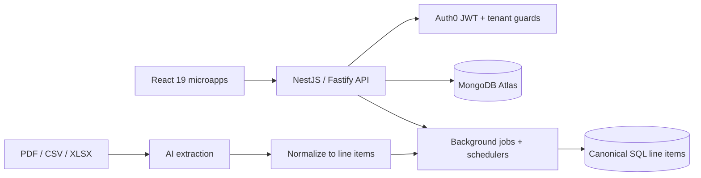
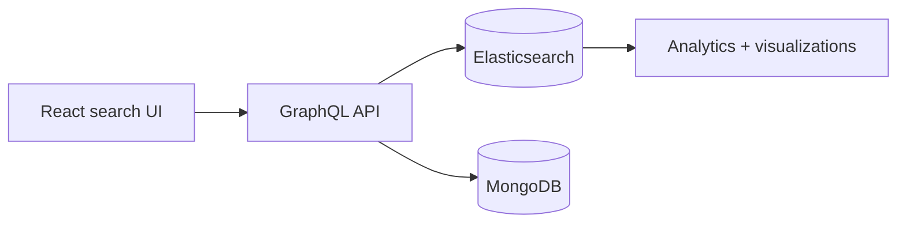

# Hi, I'm Danyal 👋

**Full-Stack Software Engineer** building AI, data and geospatial platforms. 4 years shipping production systems with React, TypeScript, NestJS and Node.js, from tenant-scoped APIs and background job pipelines to the interfaces analysts work in.

📫 [LinkedIn](https://linkedin.com/in/danyal-nazir-500609191) · danyalnazir10@gmail.com · Lahore, Pakistan

---

## 🧰 Stack

**Frontend:** React 19, Next.js, TypeScript, Redux, Redux Saga, Jotai, TanStack Query, Tailwind CSS, MUI, Vite 
**Backend:** Node.js, NestJS (Fastify), Express, GraphQL, REST, background jobs & schedulers 
**AI & Search:** OpenAI, LLM document extraction (PDF / CSV / XLSX), Elasticsearch, workflow automation 
**Data:** MongoDB Atlas, Elasticsearch, Firestore 
**Geospatial:** deck.gl, Mapbox GL, 3D map visualization, geospatial data ingestion 
**Architecture & Auth:** multi-tenant architecture, tenant-scoped authorization, Module Federation, Auth0, JWT, Firebase Auth, Stripe 
**Testing:** Playwright, Cypress

---

## 🔒 Work I can't open-source

Most of my commercial work lives in private repositories. Here's what I built and how. Happy to walk through the code and design decisions live.

### 1. AI-powered real-asset intelligence platform
*React 19, TypeScript, NestJS (Fastify), MongoDB Atlas, Auth0, deck.gl*

- Building multi-tenant NestJS APIs on MongoDB Atlas with Auth0 JWT authentication and tenant-scoped authorization guards.
- Implementing document import pipelines that normalize AI-extracted CSV, XLSX and PDF statements into a canonical SQL line-item grain, with batched persistence and background job progress.
- Adding scheduled workflow automations and board-scoped permission resolution behind reminder scans and rule-driven task workflows.
- Developing the React 19 frontend with Jotai and TanStack Query, plus module-federated microapps sharing one component and data-table layer.
- Delivering deck.gl and Mapbox GL surfaces for 3D visualization of asset and production data.

### 2. Oil reserves analytics & agreements platform
*React, Node.js, GraphQL, Elasticsearch, MongoDB*

- Building and maintaining a full-stack platform for analytics and management of oil reserve agreements across the United States.
- Developing data visualizations and search-driven UIs on Elasticsearch that surface insights from large datasets.
- Designing GraphQL APIs that power real-time agreement workflows, working across backend and frontend.

### 3. Wildfire & reforestation monitoring (Monte Pisano, Italy)
*Sole developer · React, deck.gl, NestJS, MongoDB, Tailwind CSS*

- Architected and delivered, on my own, an interactive geospatial platform for wildfire monitoring and reforestation tracking.
- Built 3D map visualizations with deck.gl and a responsive, accessible UI in Tailwind CSS.
- Designed the NestJS + MongoDB backend with REST APIs for geospatial data ingestion and retrieval.

### 4. Audio flashcards & study games platform
*React, Vite, Firebase, Stripe, Playwright*

- Built a learning platform that generates study decks and interactive practice flows, with a photo-based learning mode.
- Implemented Firebase Auth (Google OAuth, email/password, magic link) with anonymous-to-registered upgrades that keep guest progress.
- Added Stripe checkout for subscriptions and credit packs, with entitlement and usage tracking in Firestore.
- Covered auth, onboarding and purchase-return journeys with Playwright E2E tests.

### 5. Workforce management platform
*React, Redux Saga, TypeScript, Node.js, MongoDB*

- Contributed to a system for hiring, payroll, time tracking and benefits reimbursement.
- Implemented Redux Saga state flows that keep data consistent across modules.

---

## 📈 Elsewhere

- B.S. Software Engineering, PUCIT (2019 – 2023)
- English (proficient) · Urdu (native)
